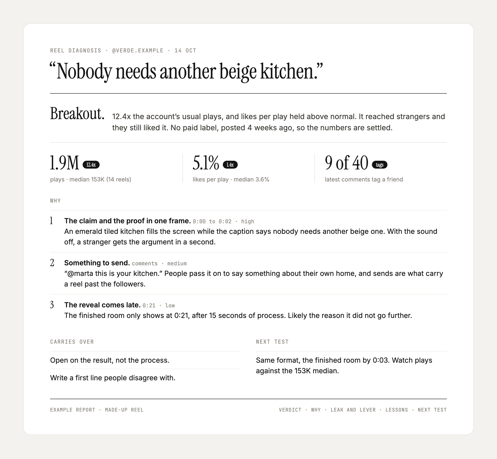

# Reel Diagnosis

Tells you why an Instagram reel performed the way it did, and what to do differently next time.



## Why I built it

I manage Instagram accounts for brands. Most reel analysis stops at describing the video, which anyone can see for themselves. What I need is the why: did it win or lose for this account, what in the video caused it, and what to change on the next one. This skill does that, the same way for a hit as for a flop.

## What it does

- **Verdict.** Breakout, reached but did not land, loved but did not travel, missed, or in line. Measured against the account's own reels, never against generic benchmarks.
- **Why.** Two to four causes, each tied to the second it happens, the signal it moved, and how sure it is.
- **Leak and lever.** The one thing that cost the reel most, and the one thing that carried it.
- **Lessons.** What carries over to your next reel, and what not to copy.
- **Next test.** One change to try, and the number that will show whether it worked.

It works on your own reels and on anyone else's, from just a link.

## How it works

You paste a reel link. The skill downloads the reel with its sound, cuts it into frames, finds every edit and pause, and transcribes the voice. It reads the post's likes and comments, and the play counts of the account's other reels, to know what normal looks like. Then it reads all of that against what Instagram says it ranks on: watch time, likes and sends.

For your own reels you can go deeper. Connect your Instagram data (through a tool such as Supermetrics, Porter Metrics, Metricool or Composio) or send screenshots of the reel's Insights, and it shows the second people left and how many shared it.

## Install

**Best: the Claude desktop app, in the Code tab**

This is where it can download the reel, hear the voice and read the account.

1. Open the Claude desktop app on your computer and go to the Code tab.
2. Paste this and send it:

```
Install this skill: https://github.com/lourencosousa/reel-diagnosis
```

3. Say yes when Claude asks to approve a step.

Use the desktop app, not Claude Code in the browser (claude.ai/code). The browser version runs on a computer in the cloud and forgets the skill when the session ends.

It needs [ffmpeg](https://ffmpeg.org/download.html). On the first run it offers to install two free tools: yt-dlp, to download the reel, and faster-whisper, to hear the voice.

Already use Claude Code in a terminal? Run:

```bash
git clone https://github.com/lourencosousa/reel-diagnosis ~/.claude/skills/reel-diagnosis
```

**Claude chat (claude.ai)**

1. Download [reel-diagnosis.zip](https://github.com/lourencosousa/reel-diagnosis/releases/latest/download/reel-diagnosis.zip). Don't unzip it.
2. In Claude, open Settings, then Capabilities, and make sure code execution is on.
3. Open Customize, then Skills. Click "+", then "Create skill", then "Upload a skill", and choose the zip.

Use this zip, not GitHub's "Download ZIP" button: that one renames the folder and Claude rejects it. In the chat it cannot download reels, so it works from screenshots of the key moments, with no sound.

## Use

Paste a reel link and ask what you want to know:

- "Why did this reel flop?"
- "Diagnose this reel."
- "What can I learn from this one?"

## Good to know

- It is free. It runs on the Claude plan you already have, with no API keys.
- It reads only what is public, unless you connect your own data.
- Downloading reels may go against Instagram's terms. Use it for your own analysis.

## Status

I use it on the accounts I manage, on every reel worth learning from.

Made by Lourenço Sousa · [GitHub](https://github.com/lourencosousa) · [LinkedIn](https://www.linkedin.com/in/louren%C3%A7o-sousa-948195304/)

## License

MIT
